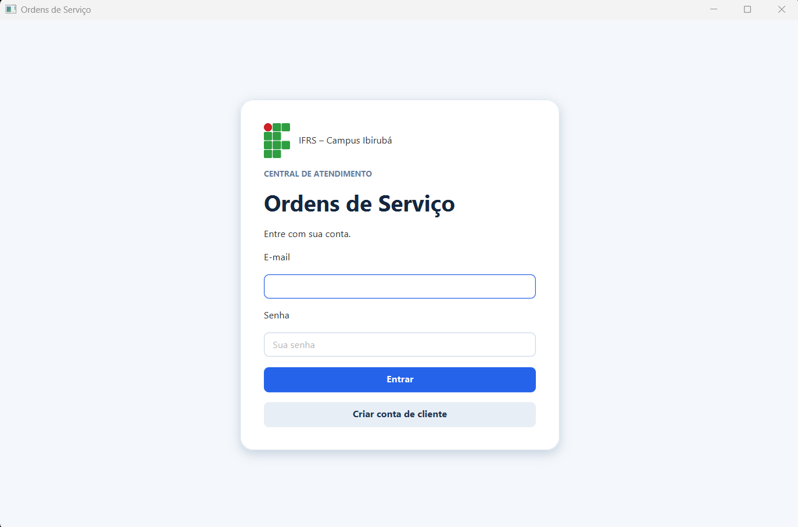
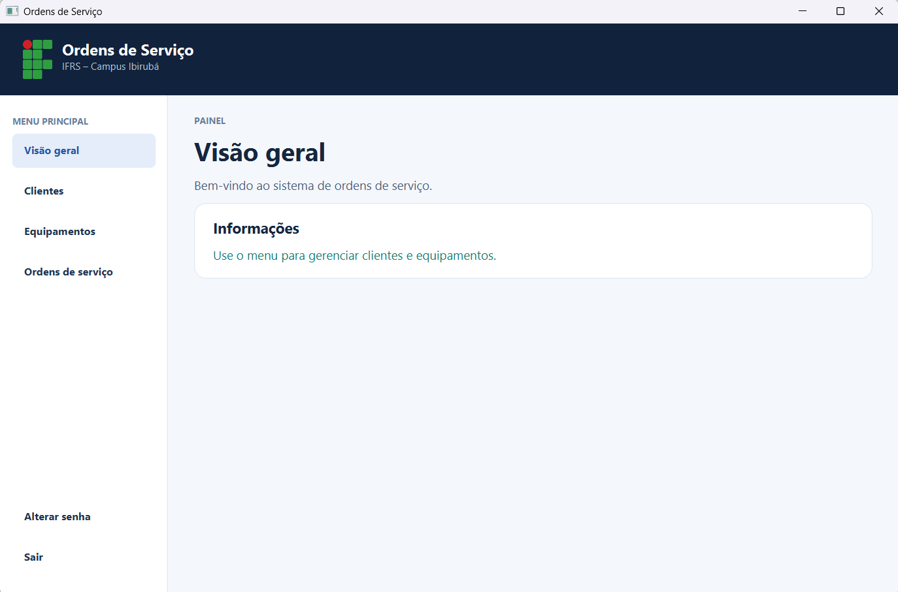
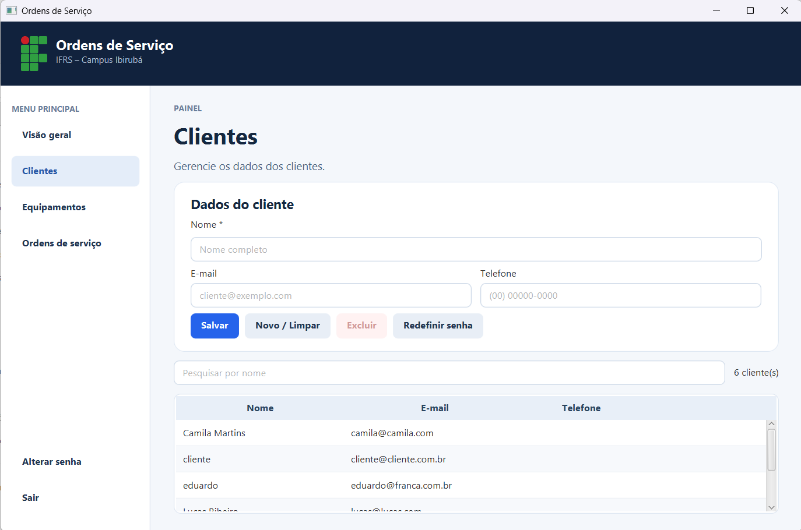
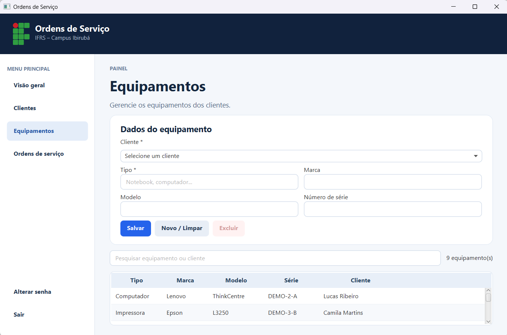
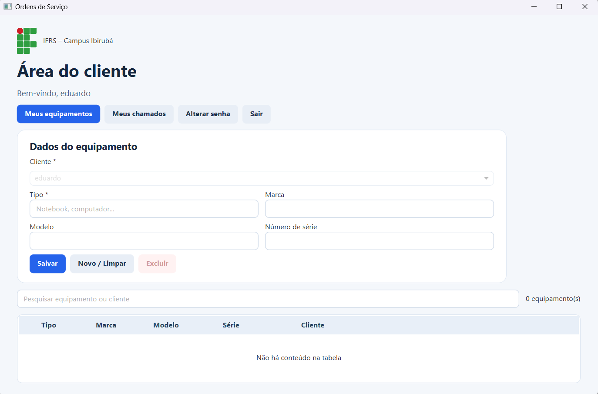

# Ordens de Serviço

Sistema desktop para gerenciamento de chamados internos de TI, desenvolvido como trabalho final da disciplina de Linguagens de Programação III, do curso de Ciência da Computação do IFRS Campus Ibirubá.

## Objetivo

O sistema foi desenvolvido para facilitar o registro e o acompanhamento de chamados técnicos, permitindo organizar os usuários, seus equipamentos e as solicitações de atendimento em um único local.

## Autor

Eduardo França

## Funcionalidades

- Login de administrador e cliente.
- Cadastro, edição, pesquisa e exclusão de clientes.
- Cadastro, edição, pesquisa e exclusão de equipamentos.
- Abertura e acompanhamento de chamados.
- Alteração do status dos chamados.
- Registro da solução ou motivo do cancelamento.
- Alteração e redefinição de senhas.
- Controle de acesso conforme o perfil do usuário.

## Tecnologias utilizadas

- Java 21
- JavaFX
- FXML
- CSS
- Maven
- JPA/Hibernate
- SQLite
- JUnit 5

## Banco de dados

O sistema utiliza SQLite para armazenar os dados. O banco é criado automaticamente na pasta `dados/cfservice.db`.

As principais entidades são:

- `Cliente`: informações dos clientes.
- `Equipamento`: equipamentos vinculados aos clientes.
- `OrdemServico`: informações dos chamados.
- `Usuario`: dados de autenticação e perfil de acesso.

Os chamados podem estar abertos, em andamento, concluídos ou cancelados.

## Estrutura do projeto

```text
src/
├── main/
│   ├── java/
│   │   └── br/com/cftecnologia/ordens/
│   │       ├── controller/
│   │       ├── model/
│   │       ├── persistencia/
│   │       ├── repository/
│   │       └── MainApp.java
│   └── resources/
│       ├── META-INF/
│       ├── images/
│       ├── styles/
│       └── view/
└── test/
```

## Como executar

É necessário ter o Java 21 e o Maven instalados.

Clone o repositório:

```bash
git clone https://github.com/dudufc/Ordens-de-Servico.git
cd Ordens-de-Servico
```

Execute a aplicação:

```bash
mvn clean javafx:run
```

Para executar os testes:

```bash
mvn clean test
```

## Persistência

A comunicação com o banco de dados é feita utilizando JPA e Hibernate. As operações de gravação utilizam transações, com rollback em caso de erro.

## Diagrama de classes


## Telas do sistema

### Login



### Painel administrativo



### Clientes



### Equipamentos



### Portal do cliente


